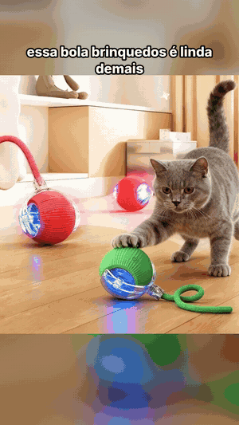

# Robô de vídeos de ofertas

Robô em Python que, sozinho, **encontra um produto em alta, escreve o roteiro com IA e monta um vídeo vertical curto** no estilo "achadinhos" (foto em movimento, narração com voz neural, música, legendas palavra por palavra e etiqueta de preço). O vídeo chega no **Telegram** com a legenda pronta para postar no TikTok, Reels ou Shorts.

> 🇺🇸 *Python bot that finds trending products, writes the script with AI and renders short vertical videos with neural voice, music and animated captions, delivered on Telegram twice a day.*

<p align="center"></p>

## Como funciona

```
Agendador (11h e 19h) → busca produtos na API de afiliados → filtra por nota, desconto e vendas
   → IA escreve gancho, falas e legenda → monta o vídeo (Pillow + FFmpeg + edge-tts)
   → envia no Telegram: vídeo + legenda + link
```

- **Reveza o nicho** a cada execução (casa, tecnologia, moda, beleza, calçados) e não repete produto (histórico).
- **Roteiro com IA:** com `ANTHROPIC_API_KEY`, o Claude escreve o gancho e a fala de cada produto. Sem a chave, usa frases prontas por categoria.
- **Estilo por categoria:** cores e textos mudam conforme o tipo de produto (`estilos.py`).
- **Dois modos de vídeo:**
  - `ugc`: o robô monta o vídeo inteiro com as fotos do produto.
  - `ia`: gera um storyboard com IA (Gemini) e o prompt pronto para o YouTube Create. Depois, o **editor no Telegram** (`editor_bot.py`) recebe o vídeo gerado e finaliza: gancho, voz, legenda e preço.
- **TikTok (opcional):** envia o vídeo para os rascunhos pela Content Posting API (`tiktok.py`).

## Tecnologias

Python · Pillow · FFmpeg · edge-tts (voz neural) · API do Claude · Gemini API · Telegram Bot API · TikTok Content Posting API · Agendador do Windows / cron

## Estrutura

```
bot_videos.py        robô principal (o agendador chama este)
shopee_api.py        busca e filtro de produtos na API de afiliados
gerar_video_ugc.py   vídeo de 1 produto: fotos em movimento, voz, legenda
gerar_video.py       estilo "lista com 5 produtos"
storyboard.py        modo IA: storyboard + prompt para o YouTube Create
editar_video.py      finaliza o vídeo gerado na IA
editor_bot.py        editor que fica ouvindo o Telegram
estilos.py           cores e textos por categoria
tiktok.py            envio para os rascunhos do TikTok
```

## Como rodar

```bash
python -m venv venv
venv\Scripts\pip install -r requirements.txt     # no Linux: venv/bin/pip
copy .env.example .env                           # preencha as chaves
venv\Scripts\python bot_videos.py --teste --enviar --modo ugc   # vídeo de teste no seu Telegram
```

Precisa do **FFmpeg** instalado. Para deixar automático no Windows, rode `agendar_videos.bat` (11h e 19h). No Linux, use o cron:

```
CRON_TZ=America/Fortaleza
0 11,19 * * * cd ~/robo-videos && venv/bin/python bot_videos.py >> cron.log 2>&1
```

## Autor

**João Levy**: desenvolvedor back-end (Python e Java) · [LinkedIn](https://www.linkedin.com/in/joao-levy-4008521b2) · [GitHub](https://github.com/levyespigue14-ux)

## Licença

[MIT](LICENSE)
